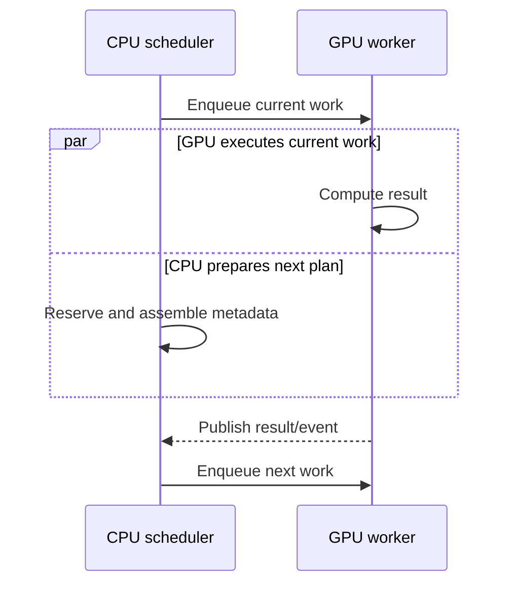

# {{TITLE}}

## {{SUBTITLE}}

> **Core mental model:** {{State the central mechanism or dependency in one or two sentences.}}

{{Explain what the note connects and what the reader should be able to reason about after reading it.}}

---

## Scope and version note

{{State what is in scope, which implementations or versions are discussed, and what “current” means.}}

| Source | Version or date | Role in this note |
|---|---|---|
| {{Primary source}} | {{Version}} | {{Concept, mechanism, or evidence}} |
| {{Pinned implementation}} | {{Commit/tag}} | {{Exact behavior}} |

---

## Contents

1. [Mental model](#mental-model)
2. [Terminology and notation](#terminology-and-notation)
3. [Baseline](#baseline)
4. [Mechanism](#mechanism)
5. [Worked example](#worked-example)
6. [Special cases](#special-cases)
7. [Correctness and failure modes](#correctness-and-failure-modes)
8. [Complete pseudocode](#complete-pseudocode)
9. [Summary and references](#summary-and-references)

---

## Mental model

{{Give the shortest accurate explanation. Clarify what the key term does and does not mean.}}

If timing matters, define the baseline:

$$
T_{\text{baseline}} \approx T_A + T_B.
$$

Then define the optimized relationship:

$$
T_{\text{optimized}} \approx \max(T_A, T_B).
$$

{{Interpret the equations in ordinary language and state their assumptions.}}

---

## Terminology and notation

| Symbol or term | Meaning | Scope or unit |
|---|---|---|
| $T$ | {{Definition}} | {{tokens, seconds, bytes, etc.}} |
| $C$ | {{Definition}} | {{Scope}} |
| {{Term}} | {{Definition}} | {{Scope}} |

State the core invariants:

$$
{{INVARIANT}}
$$

---

## Baseline

{{Explain the straightforward design first. Identify the avoidable critical-path work or conceptual limitation.}}

```python
def baseline():
    plan = schedule()
    result = execute_and_wait(plan)
    commit(result)
```

{{Explain ownership, blocking behavior, and state effects.}}

---

## Mechanism

### Stage 1 — {{Verb phrase}}

{{What is known, what is provisional, and what is written.}}

### Stage 2 — {{Verb phrase}}

{{What executes, which dependency orders it, and whether the host blocks.}}

### Stage 3 — {{Verb phrase}}

{{When results become visible and what becomes committed.}}



{{Restate the concurrency relationship in prose in case Mermaid is not rendered.}}

### State transitions

| Moment | Logical state | Physical state | Provisional state | Why safe |
|---|---|---|---|---|
| {{Before}} | {{...}} | {{...}} | {{...}} | {{...}} |
| {{After}} | {{...}} | {{...}} | {{...}} | {{...}} |

---

## Worked example

{{Choose concrete values and trace every stage.}}

| Step | Inputs | State before | Operation | State after |
|---:|---|---|---|---|
| 1 | {{...}} | {{...}} | {{...}} | {{...}} |
| 2 | {{...}} | {{...}} | {{...}} | {{...}} |

Explain:

- what was known;
- what was late-bound;
- what capacity was reserved;
- what synchronization occurred;
- what was committed or corrected.

---

## Special cases

### {{Variant A}}

{{Start with how it shares the baseline invariant, then explain only the delta.}}

### {{Variant B}}

{{Identify the extra uncertainty, optimistic action, correction, and resource effect.}}

| Path | Unknown state | Safe precomputation | Resolution or correction |
|---|---|---|---|
| General path | {{...}} | {{...}} | {{...}} |
| Variant A | {{...}} | {{...}} | {{...}} |
| Variant B | {{...}} | {{...}} | {{...}} |

---

## Correctness and failure modes

### Core invariants

1. {{Invariant with a testable condition.}}
2. {{Invariant with a testable condition.}}

### Failure, rollback, or cancellation

{{Distinguish logical invalidation, physical memory contents, resource release, and later reuse.}}

### Implementation quirks

{{Separate historical and current mechanisms. Pin versions or commits.}}

---

## Complete pseudocode

```python
class State:
    pass


def scheduler_loop():
    while True:
        plan = build_plan_from_stable_and_provisional_state()
        ticket = worker.enqueue(plan)          # host-side nonblocking enqueue

        if previous_ticket is not None:
            result = previous_ticket.resolve() # block only at host visibility point
            commit_or_correct(result)

        previous_ticket = ticket


def worker_loop():
    while True:
        plan = dequeue()
        resolved = resolve_late_bound_values(plan)
        output = execute(resolved)
        publish_device_and_host_results(output)
```

{{Map each pseudocode operation back to the state table and diagram.}}

---

## Summary and references

### Final mental model

{{Give the memorable explanation in three to six sentences.}}

### Checklist

- {{What the reader should verify in another implementation.}}
- {{What changes for variants.}}
- {{Where synchronization cannot be removed.}}

### Glossary

| Term | Meaning |
|---|---|
| {{Term}} | {{Definition}} |

### References

- [{{Descriptive source title}}]({{DIRECT_URL}}) — {{What it supports.}}

