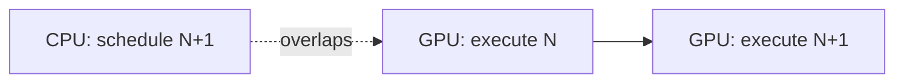

# Editorial contract

Use this reference as the detailed quality standard for converting a technical Codex conversation into a durable note.

## 1. The transformation

The source is conversational and iterative:

- questions arrive in an imperfect order;
- early answers may simplify too much;
- user annotations expose gaps;
- later answers correct earlier terminology;
- code and sources may be scattered across tool outputs;
- the most useful example may appear near the end.

The destination is conceptual and canonical:

- one stable vocabulary;
- one explanation for each mechanism;
- one clearly marked distinction between abstractions and implementation details;
- a logical reading order;
- explicit evidence and version boundaries.

Do not produce a turn-by-turn summary. Reconstruct the best current model supported by the whole conversation.

## 2. Evidence priority

When sources disagree, use this priority order:

1. explicit user correction or clarified intent;
2. verified primary source at the relevant version;
3. pinned source code and tests;
4. official documentation or release notes;
5. paper or dissertation prose;
6. earlier assistant explanation;
7. unverified inference.

This is not a universal authority hierarchy. It is a practical rule for reconstructing what the chat was trying to explain. For example, source code is authoritative about one pinned implementation, while a paper may be clearer about the intended abstraction.

## 3. Issue ledger

Create a private ledger before writing. A compact form is:

| ID | Reader question | Canonical answer | Evidence | Version | Note section |
|---|---|---|---|---|---|
| Q1 | What overlaps? | CPU plan construction overlaps current GPU execution | release + source | v0.4 | Mechanism |
| Q2 | How is an unknown token represented? | Late-bound handle resolved on device | pinned source | commit X | Normal decode |
| Q3 | What changes for speculation? | A future bundle and two readiness points replace one future token | source + inference | current | Speculation |

Use the ledger to ensure every annotation and follow-up is answered.

Also track contradictions:

| Claim A | Claim B | Resolution |
|---|---|---|
| “State is rolled back” | “Pages are not immediately cleared” | Logical invalidation differs from physical zeroing or freeing |

Do not expose the ledger unless it helps the user.

## 4. Source and version discipline

Use a scope/version section whenever:

- the chat discusses multiple projects;
- a design changed between releases;
- a paper describes an abstraction while current code uses different machinery;
- exact source code behavior matters;
- the term “current” appears.

Prefer a table:

| Source | Version or date | Role |
|---|---|---|
| Release post | 2024-12-04 | Introduces the design |
| Frozen implementation | commit hash | Historical mechanism |
| Current implementation | commit hash, inspected date | Present machinery |
| Dissertation | sections | Abstract model |

Use direct links to the exact artifact when possible. Explain which claims are inferred from source ordering or data flow.

Never silently mix:

- two different releases;
- two backends;
- conceptual and physical state;
- scheduler-side and worker-side behavior;
- logical invalidation and memory reclamation.

## 5. Explanation architecture

### Core mental model

Open with one short statement that captures the mechanism's central dependency.

Good:

> The scheduler can prepare the next execution plan before the current result is known if every unknown value is represented by a handle that is resolved before consumption.

Weak:

> This note explains asynchronous scheduling.

### Baseline first

Show what the unoptimized or naive loop does and why its critical path contains avoidable work. Then introduce the optimization as a transformation of that baseline.

### State before operations

For stateful systems, define the state tuple:

$$
S = (T, C, B, M)
$$

where every symbol is defined immediately. Then explain which operation reads or writes each component.

### Stages and transitions

Name stages using verbs and state effects:

```text
reserve → launch → resolve → commit → release
```

If multiple paths exist, state the branch condition and show where paths rejoin.

### Invariants

Write invariants in a form a reader can test:

$$
0 \le C \le T
$$

```text
A value may be unknown while the plan is built, but it must be resolved before the first kernel that consumes it.
```

Place each invariant close to the mechanism it constrains.

## 6. Mathematics

Use math to make relationships precise, not to decorate prose.

Requirements:

- define every symbol;
- state units where relevant;
- distinguish exact equalities from approximations;
- state assumptions before deriving a result;
- interpret the result in plain language;
- reuse notation consistently.

For a timing model, include both baseline and overlap:

$$
T_{\text{serial}} \approx T_A + T_B
$$

$$
T_{\text{overlap}} \approx \max(T_A, T_B)
$$

Then state the hidden-overhead condition:

$$
T_B \le T_A.
$$

Avoid LaTeX environments that GitHub or RemNote may handle inconsistently. Prefer simple display blocks, aligned prose, and small equations.

## 7. Pseudocode

Pseudocode must expose causality and ownership. Include:

- the owner of each queue or state object;
- whether an operation blocks;
- whether a value is logical, provisional, host-visible, or device-resident;
- the synchronization event;
- the commit point;
- cleanup or rollback.

Prefer:

```python
def scheduler_step():
    plan = build_next_plan(state_snapshot)
    ticket = worker.enqueue(plan)       # nonblocking host operation
    result = previous_ticket.resolve()  # blocks only when host data is needed
    commit(result)
```

Over pseudocode that merely renames prose:

```python
schedule()
run()
finish()
```

When concurrency is central, present both:

1. component pseudocode for each thread, stream, or process;
2. a timeline showing what overlaps.

Make placeholders explicit:

```python
next_input = FutureValue(slot=request_slot)
```

Then show the exact resolution site:

```python
resolved_input = future_map.gather(next_input.slot)
```

## 8. Worked examples

Use one running example when a mechanism has several coupled states.

A good example:

- assigns concrete token counts, slots, or timestamps;
- shows state before and after each stage;
- includes the exceptional path;
- reconciles the example with the formula or pseudocode.

For counters, use a table:

| Moment | $T$ | $C$ | Meaning |
|---|---:|---:|---|
| Before scheduling | 8 | 8 | No pending logical token |
| Future token appended | 9 | 8 | One logical token not yet computed |
| Forward completes | 9 | 9 | KV state catches up |

Do not use an example that contradicts the actual batching granularity or cache semantics.

## 9. Diagrams

Use Mermaid for:

- concurrency timelines;
- state machines;
- one producer feeding multiple consumers;
- branching and rollback;
- component ownership.

Use quoted labels when punctuation appears:



Every diagram needs surrounding prose that communicates the same essential fact if Mermaid does not render.

Do not put a diagram around a one-step statement. A short equation or sentence is clearer.

## 10. Comparisons and special cases

When the chat compares a general path with variants, start with the common invariant and then isolate the delta.

Example:

| Path | Unknown future state | Safe precomputation | Correction |
|---|---|---|---|
| Ordinary decode | One token ID | Membership and capacity | Late-bind token |
| Prefix cache | Exact hit length | Candidate lookup | Revalidate hit |
| Speculation | Accepted length and replacement token | Reserve upper bound | Compact/release suffix |

Do not repeat the full baseline for every variant. Link each variant back to the shared pipeline.

For each special case, answer:

- What extra uncertainty appears?
- What can still be scheduled optimistically?
- What must wait?
- What is the correction operation?
- What resource becomes temporarily over-reserved?
- Does correction change logical state, physical state, or both?

## 11. GitHub and RemNote portability

Use:

- one H1;
- ATX headings (`## Heading`);
- blank lines around lists, tables, equations, and code blocks;
- inline math as `$x$`;
- display math as:

```text
$$
x = y + z
$$
```

- fenced code with a language;
- fenced Mermaid;
- standard Markdown links;
- simple pipe tables.

Avoid by default:

- YAML/Jekyll front matter in the output note;
- raw HTML;
- collapsible `<details>`;
- custom admonition syntax;
- nested tables;
- LaTeX delimiters `\(...\)` and `\[...\]`;
- headings that differ only by punctuation;
- autolinks whose visible text is an unreadable full URL;
- dependency on GitHub-only callout rendering.

A blockquote with a bold label is a portable callout:

```markdown
> **Core invariant:** The exact value may be late-bound, but capacity must be reserved before execution.
```

## 12. Semantic consistency checks

Before delivery, verify:

- every symbol has one meaning;
- every counter update has a corresponding state effect;
- examples obey the stated invariants;
- pseudocode uses the same ordering as diagrams;
- a “nonblocking” operation is nonblocking from the stated actor's perspective;
- a CUDA launch is not confused with GPU completion;
- host-visible completion is distinct from device-side readiness;
- reserved capacity is distinct from written memory;
- logical length is distinct from computed length;
- rollback semantics distinguish invalidation, release, and zeroing;
- “zero overhead” is described as hidden critical-path work, not zero CPU work.

## 13. Common failure modes

### Transcript compression

Symptom: the note says “then the user asked” and preserves message order.

Fix: reorganize around concepts and fold each correction into the canonical section.

### Premature abstraction

Symptom: the note says “work overlaps” without naming the exact CPU work, GPU kernels, events, or dependencies.

Fix: add a stage table, timeline, and ownership-aware pseudocode.

### Version soup

Symptom: historical negative token IDs and a newer future-map design are described as one simultaneous implementation.

Fix: split conceptual invariant, historical implementation, and current implementation.

### False certainty

Symptom: an implementation inference is stated as documented behavior.

Fix: label the inference and cite the source ordering that supports it.

### Overfitted code

Symptom: pseudocode copies unstable internal class names and obscures the general mechanism.

Fix: show conceptual pseudocode first, then map it to implementation names in a separate section.

### Superficial completeness

Symptom: the note mentions every topic but never explains state transitions.

Fix: cut repeated overview prose and spend the space on counters, events, examples, rollback, and invariants.

## 14. Final review questions

Ask:

1. Can a reader explain the mechanism without seeing the chat?
2. Can they identify exactly what overlaps?
3. Can they identify every unavoidable synchronization point?
4. Can they trace the normal path and one exceptional path?
5. Do the math, example, diagram, and pseudocode tell the same story?
6. Are implementation versions pinned where necessary?
7. Are user-raised confusions answered explicitly?
8. Does the note remain readable if Mermaid is not rendered?
9. Do all internal links and Markdown fences validate?
10. Is the final mental model short enough to remember?

